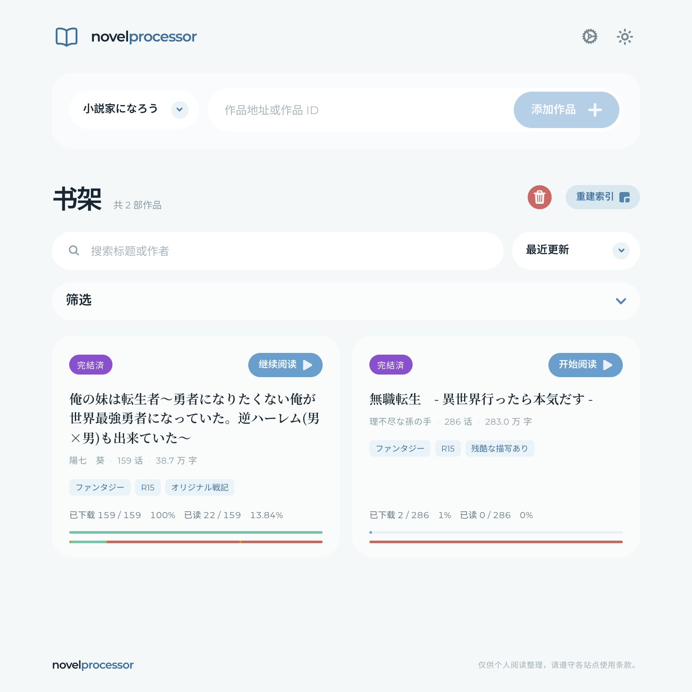
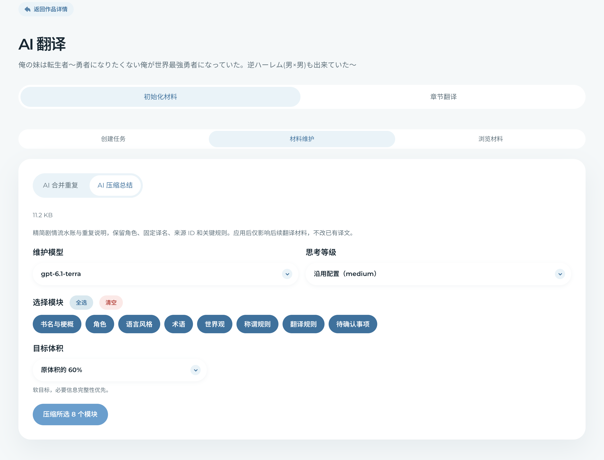
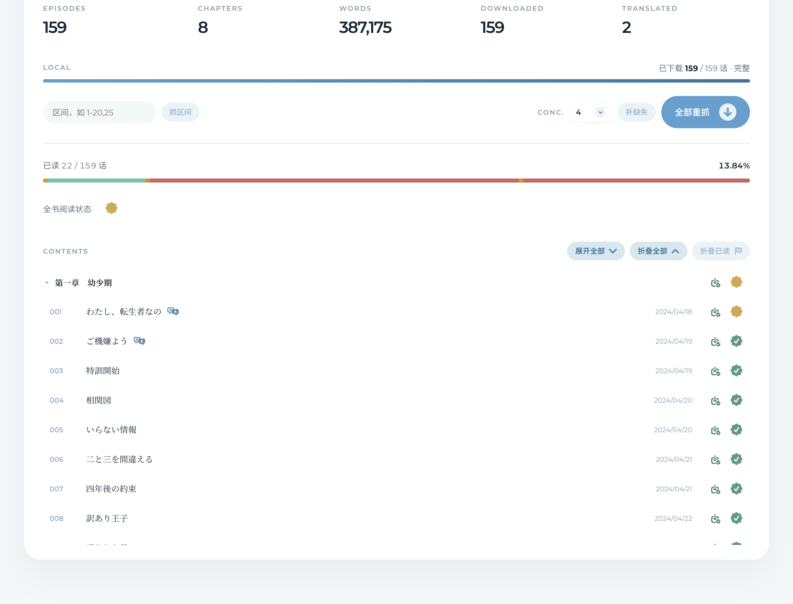
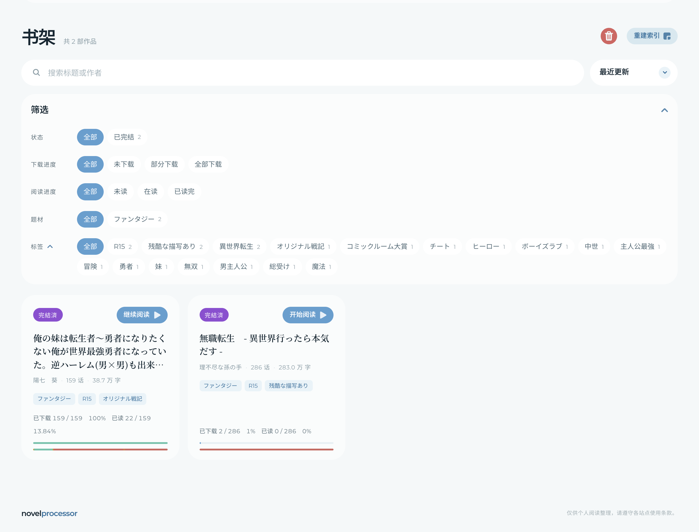
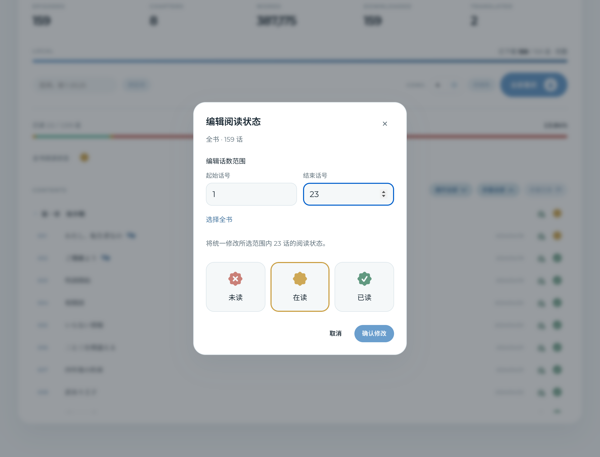
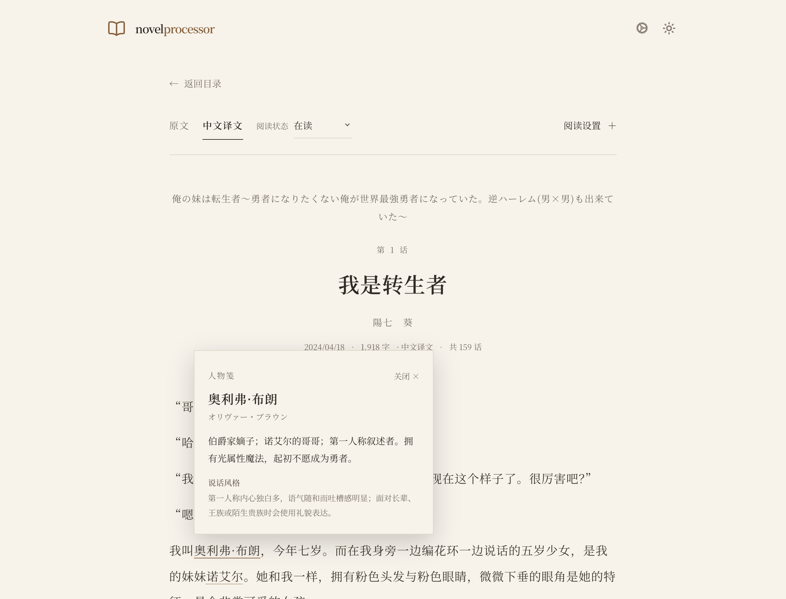
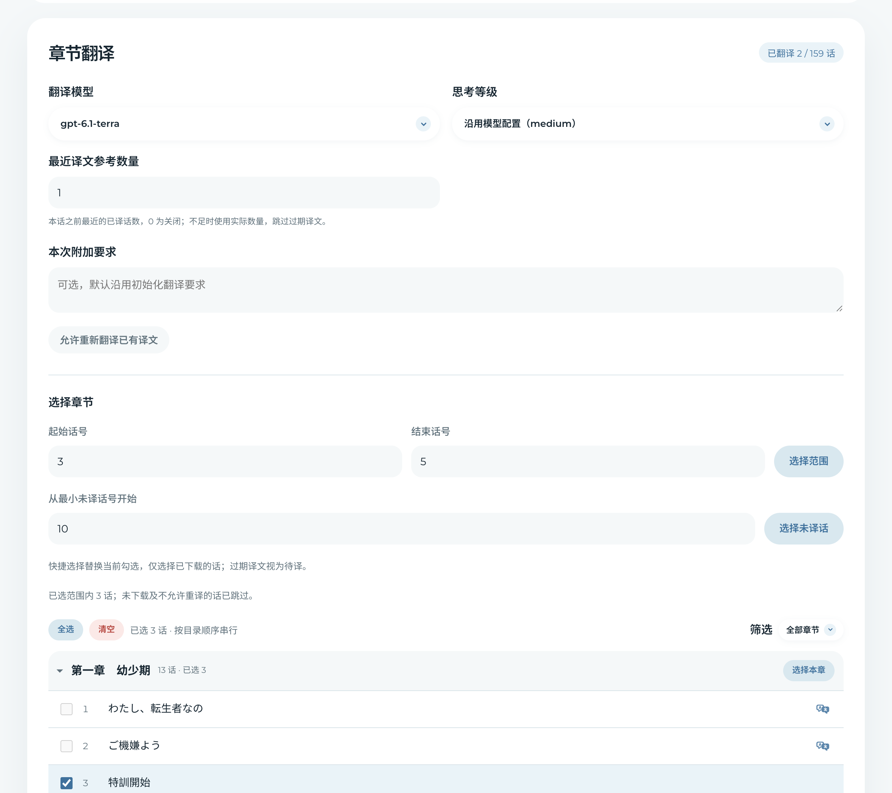
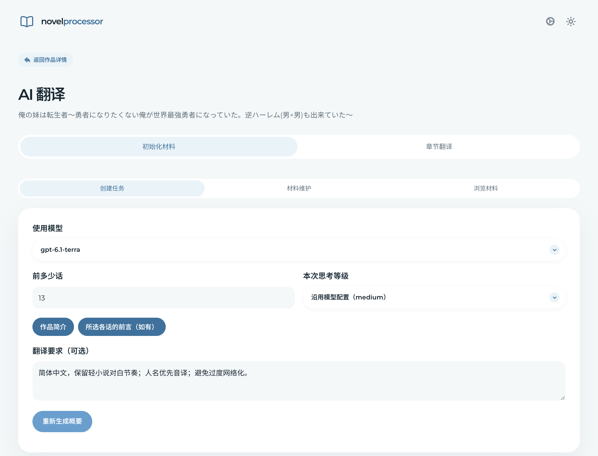
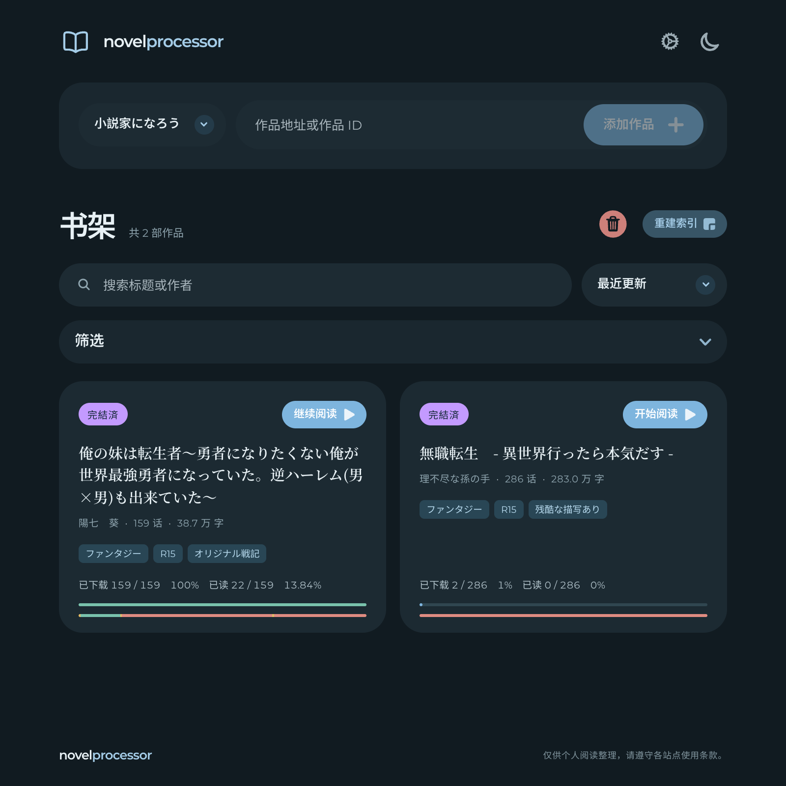

# novel-processor

<p align="center">
  
</p>

<p align="center">
  <strong>Bring the Japanese light novels you love to your own bookshelf.</strong>
</p>

<p align="center">
  <a href="https://github.com/Chiyoshic/novel-processor/releases"></a>
  <a href="https://github.com/Chiyoshic/novel-processor/releases/tag/v1.0.0"></a>
  <a href="./LICENSE"></a>
  <a href="#requirements"></a>
  <a href="./novel-processor/frontend"></a>
  <a href="./novel-processor/backend"></a>
  <a href="./novel-processor/docs/features/06-ai-translation.md"></a>
  <a href="./novel-processor/docs/features/07-pwa.md"></a>
</p>

<p align="center">
  <a href="./README.md">简体中文</a> · <strong>English</strong><br />
  More language versions are coming soon.
</p>

> This README covers **v1.0.0**. Syosetu is currently supported, with more platforms planned. See [Releases](https://github.com/Chiyoshic/novel-processor/releases) for published versions and release notes.
>
> This is the English README. The application currently uses a primarily Chinese interface and translates Japanese novels into Chinese; this document does not introduce additional UI or translation languages. Detailed linked guides are currently in Chinese.

<a id="overview"></a>
## Overview

A personal Japanese light novel library with novel fetching, bookshelf management, immersive reading, and context-aware AI translation powered by evolving character, terminology, and style guides.

The browser interface connects to a standalone Node.js API, with source text, translations, and personal data stored on your own server or computer. It is built for personal use, without public content distribution or open registration. AI features send the relevant material to your configured model provider.

Here, a **chapter** is a table-of-contents group, while an **episode** is an individual installment with its own text. Downloads, translation, reading records, and initialization samples primarily operate on episodes.

<p align="center">
  <a href="./novel-processor/docs/assets/readme/bookshelf.webp">
    <picture>
      <source media="(prefers-color-scheme: dark)" srcset="./novel-processor/docs/assets/readme/bookshelf-dark.webp" />
      
    </picture>
  </a>
  <br /><sub>Actual UI rendered with existing local library data. The preview follows your color scheme; click to enlarge.</sub>
</p>

<a id="translation-highlights"></a>
## More than isolated episode translation

Rather than translating each episode in isolation, `novel-processor` maintains an **evolving translation guide** for the novel, giving later episodes a consistent foundation:

- **Understand first, translate second:** Use the synopsis, prefaces, and opening episodes to establish a Chinese title, plot summary, character names, terminology, and style baseline.
- **Carry the context forward:** Combine the latest guide with recent translations to help maintain narrative continuity, names, and tone instead of starting from scratch.
- **Let the guide grow with the story:** The model proposes updates to characters, aliases, terms, and rules. Validated changes are saved for subsequent episodes.
- **Keep the guide focused:** Merge duplicates and summarize selected sections with AI. Preview changes before applying them, with revision history available for restoration.

The goal is to reduce naming drift, inconsistent style, and repetitive notes across a long novel. Results still depend on the model and source material, and human review remains important.

<table>
  <tr>
    <td width="50%" align="center"><a href="./novel-processor/docs/assets/readme/translation-guide.webp"></a></td>
    <td width="50%" align="center"><a href="./novel-processor/docs/assets/readme/guide-maintenance.webp"></a></td>
  </tr>
  <tr>
    <td align="center">A shared character and style reference</td>
    <td align="center">Keep the guide focused with selective summarization</td>
  </tr>
</table>

## Contents

- [Overview](#overview)
- [Translation highlights](#translation-highlights)
- [Features](#features)
- [Supported platforms](#sites)
- [Stack and runtime architecture](#architecture)
- [Requirements](#requirements)
- [Quick start](#quickstart)
- [Configuration and deployment](#configuration)
- [Data and backups](#storage)
- [Testing and releases](#testing)
- [Documentation](#documentation)
- [Responsible use and limitations](#boundaries)
- [License](#license)

<a id="features"></a>
## Features

### Novel fetching and downloads

- Import a novel URL or a platform-specific novel ID.
- Fetch the catalog, chapter groups, episode titles, publication dates, synopsis, author, status, tags, and word counts.
- Download individual episodes, ranges, chapter contents, or an entire novel.
- Skip saved content by default, with an option to fetch it again.
- Control concurrency, request intervals, timeouts, retries, and server-side cancellation.
- Store content in JSON files and indexes in SQLite.

<p align="center">
  <a href="./novel-processor/docs/assets/readme/catalog.webp"></a>
  <br /><sub>Downloads, translations, and reading status in one catalog.</sub>
</p>

### Bookshelf and library management

- Search by title or author; filter by platform, status, and tags.
- Filter download progress and reading progress independently.
- View download and reading statistics alongside an episode-by-episode reading status bar.
- Start reading or resume the furthest episode marked as in progress.
- See download, translation, and reading status icons in the catalog.
- Move books to trash, restore them, permanently delete them, or synchronize indexes from disk.

<p align="center">
  <a href="./novel-processor/docs/assets/readme/library-filters.webp"></a>
  <br /><sub>Filter download and reading progress independently, and collapse filters or tags when not needed.</sub>
</p>

<details>
<summary>See reading status editing by episode range</summary>

<p align="center">
  <a href="./novel-processor/docs/assets/readme/reading-progress.webp"></a>
</p>

</details>

### Reader

- Switch between Japanese source text and Chinese translations.
- Read in a book-like layout using Noto Serif JP and Noto Serif SC.
- Adjust font size, letter spacing, line height, paragraph spacing, background, and text color.
- Match character names using original names, Chinese names, full names, and common short forms.
- Hover on desktop or tap on mobile to view character notes.
- Use semantic article markup and print styles; Safari decides whether Reader mode is available.
- Share reading status between source text and translations.

<p align="center">
  <a href="./novel-processor/docs/assets/readme/reader.webp"></a>
  <br /><sub>A continuous book-like layout that keeps the text in focus.</sub>
</p>

<details>
<summary>See reading preferences and character notes</summary>

<p align="center">
  <a href="./novel-processor/docs/assets/readme/reader-settings.webp"></a>
  <br /><sub>Adjust typography and colors directly in the reader.</sub>
</p>
<p align="center">
  <a href="./novel-processor/docs/assets/readme/character-notes.webp"></a>
  <br /><sub>Character hints reuse the saved translation guide.</sub>
</p>

</details>

### AI translation

- Initialize a Chinese title, plot summary, character names, aliases, style, terminology, and translation rules.
- Translate episodes sequentially, with range selection and shortcuts for the earliest untranslated episodes.
- Reference recently translated episodes to help preserve context and style.
- Use OpenAI Responses API, Chat Completions API, or compatible providers.
- Configure custom Base URLs, plaintext API keys, headers, extra request bodies, and token limits.
- Configure OpenAI / DeepSeek reasoning levels and DeepSeek DSML response adaptation.
- Monitor streamed output, bounded retries, JSON repair, and generation limits: 60 minutes total per generation and 180 seconds of upstream inactivity by default.
- Apply validated guide updates and maintain the guide through deduplication, summarization, previews, and revision restoration.

<p align="center">
  <a href="./novel-processor/docs/assets/readme/episode-translation.webp"></a>
  <br /><sub>Select an episode range, set the reference count, and open existing translations from the list.</sub>
</p>

<details>
<summary>See translation initialization settings</summary>

<p align="center">
  <a href="./novel-processor/docs/assets/readme/translation-setup.webp"></a>
  <br /><sub>Existing guide and configuration only; no paid model calls were started to create these screenshots.</sub>
</p>

</details>

### Themes and PWA

- Light, dark, and system-following themes.
- Responsive mobile and desktop layouts.
- Apple Touch Icons, maskable / monochrome icons, a manifest, and a Service Worker.
- App-shell caching only; authentication data, novel text, and AI streams are not cached for offline use.

<table>
  <tr>
    <td width="66%" align="center"><a href="./novel-processor/docs/assets/readme/bookshelf-dark.webp"></a></td>
    <td width="34%" align="center"><a href="./novel-processor/docs/assets/readme/reader-mobile-dark.webp"></a></td>
  </tr>
  <tr>
    <td align="center">Desktop dark theme</td>
    <td align="center">Mobile night reading</td>
  </tr>
</table>

Screenshots show the current Chinese interface. The mobile image uses browser viewport emulation, not a verified native iOS installation or Liquid Glass effect. [Screenshot notes](./novel-processor/docs/assets/readme/README.md)

<a id="sites"></a>
## Supported platforms

### Available now

- 小説家になろう (Syosetu)

### Planned

- カクヨム (Kakuyomu)
- アルファポリス (Alphapolis)
- ノベルアップ＋ (Novelup Plus)
- エブリスタ (E★エブリスタ)
- ハーメルン (Hameln)
- ノベマ！ (Novema!)

Planned platforms are not implemented in the current version. Their novels cannot yet be fetched through the application.

<a id="architecture"></a>
## Stack and runtime architecture

| Layer | Technology |
| --- | --- |
| Frontend | Vue 3, TypeScript, Vue Router, Vite |
| Backend | Node.js, TypeScript, native HTTP server |
| Database | SQLite, better-sqlite3 |
| AI | OpenAI Node SDK, Responses / Chat Completions |
| Content | Catalog and episode JSON files |
| PWA | vite-plugin-pwa, Workbox |
| Deployment | Docker Compose, static hosting, Nginx / BaoTa |

```text
Browser / PWA
    │ HTTPS API, authentication, streamed task events
    ▼
Node.js API (single instance)
    ├── SiteAdapter → catalog / episode fetching → JSON
    ├── SQLite → indexes / auth / models / translation / reading records
    └── AiModelClient → Responses / Chat Completions
```

The frontend connects directly to the backend through `VITE_API_BASE`; there is no Vite API proxy. Production deployments need both the frontend build and a running backend service.

<a id="requirements"></a>
## Requirements

- Node.js **22.12.0+**; Node.js 22 LTS is recommended.
- npm.
- Docker Engine / Docker Compose when running the backend in a container.
- Python 3 and native build tools if prebuilt native dependencies are unavailable.
- Network access to the source platform.
- A model service and the necessary API credentials for AI features.

There is no `package.json` at the repository root. The frontend and backend are separate npm projects. Run commands in the corresponding directory or use `npm --prefix`.

<a id="quickstart"></a>
## Quick start

### 1. Clone the repository

```sh
git clone https://github.com/Chiyoshic/novel-processor.git
cd novel-processor
# After the v1.0.0 release is published, pin the version if desired:
git checkout v1.0.0
```

### 2. Start the backend with Docker

From the Git repository root, copy the template. If `.env` already exists, edit it instead of overwriting it:

```sh
cp novel-processor/backend/.env.example novel-processor/backend/.env
```

Edit `novel-processor/backend/.env`. Keep the template's `/app/data` container paths and configure at least:

```dotenv
AUTH_INITIAL_USERNAME=chiyoshi
AUTH_INITIAL_PASSWORD=replace-with-your-own-strong-password
CORS_ORIGINS=http://localhost:5175
```

The initial password must contain 8–128 characters. Then start the API:

```sh
cd novel-processor/backend
docker compose up -d --build
docker compose ps
curl http://127.0.0.1:64226/healthz
```

The default API address is `http://localhost:64226`, with a health check at `/healthz`.

### 3. Start the frontend

Open a new terminal at the Git repository root:

```sh
npm --prefix novel-processor/frontend ci
cp novel-processor/frontend/.env.example novel-processor/frontend/.env
```

Set `novel-processor/frontend/.env` to:

```dotenv
VITE_API_BASE=http://localhost:64226/api
```

Start Vite:

```sh
npm --prefix novel-processor/frontend run dev -- --host localhost --port 5175 --strictPort
```

Open `http://localhost:5175/` and sign in using the backend credentials. Use `localhost` consistently for browser access to both services; avoid mixing `localhost` and `127.0.0.1` because that can affect refresh cookies.

### 4. Sign in for the first time

The backend creates the initial account only when SQLite has no users. Restarting does not overwrite an existing password. Access tokens stay in frontend memory, while refresh tokens use an HttpOnly cookie. See the [authentication guide (Chinese)](./novel-processor/docs/features/05-auth.md).

<a id="configuration"></a>
## Configuration and deployment

### Frontend

The required frontend variable is:

```dotenv
VITE_API_BASE=https://api.example.com/api
```

This value is embedded at build time. Rebuild and redeploy after changing it. See the [frontend README (Chinese)](./novel-processor/frontend/README.md).

### Backend

See [`backend/.env.example`](./novel-processor/backend/.env.example) for the full template.

| Variable | Purpose |
| --- | --- |
| `HTTP_HOST` / `HTTP_PORT` | API bind address and process port |
| `API_PORT` | Docker host port; defaults to 64226 |
| `DATA_DIR` / `DB_PATH` | Data directory and SQLite path |
| `NOVELS_DIR` / `EPISODES_DIR` | Catalog and episode JSON paths |
| `FETCH_CONCURRENCY` / `FETCH_INTERVAL_MS` | Fetch concurrency and request interval |
| `FETCH_TIMEOUT_MS` / `FETCH_MAX_RETRIES` | Fetch timeout and retry count |
| `CORS_ORIGINS` | Exact allowed frontend origins; `*` is not supported |
| `AUTH_INITIAL_USERNAME` / `AUTH_INITIAL_PASSWORD` | First-run account initialization |
| `AUTH_COOKIE_SECURE` / `AUTH_COOKIE_SAMESITE` | Refresh cookie policy |

Never commit API keys, initial passwords, or `.env` files. The Docker template uses `/app/data`; when running the backend directly from source, configure local paths instead. See the [backend README (Chinese)](./novel-processor/backend/README.md).

### Production

A typical deployment uses separate frontend and API hosts:

```text
https://novels.example.com      → Nginx → frontend/dist
https://api.example.com/api     → Nginx → Node API :64226
```

The frontend Nginx site needs History-mode routing fallback:

```nginx
location / {
    try_files $uri $uri/ /index.html;
}
```

Disable API proxy buffering and increase read timeouts for streamed requests. Deploy the complete frontend build, including the Service Worker, manifest, and icons. See the [production deployment guide (Chinese)](./novel-processor/docs/operations/02-production.md) for Docker, Nginx, CORS, and update instructions.

<a id="storage"></a>
## Data and backups

```text
data/
├── library.db             # Users, indexes, models, translation, reading records, trash
├── audit.log              # Management operation audit log
├── novels/<site>/<id>.json
└── episodes/<site>/<id>/<episode>.json
```

JSON files are the content source of truth. SQLite stores indexes and personal state. Reading records, model configurations, translation guides, translation status, revision history, users, and trash state cannot be fully reconstructed from JSON alone.

Back up the **entire `data/` directory**, including any SQLite WAL/SHM files present, rather than only `novels/` or `episodes/`. See the [backup and recovery guide (Chinese)](./novel-processor/docs/operations/03-data-backup.md).

<a id="testing"></a>
## Testing and releases

Frontend, starting from the Git repository root:

```sh
cd novel-processor/frontend
npm run typecheck
npm run test:select
npm run test:appearance
npm run build
npm run test:pwa
```

Backend, in a separate terminal at the Git repository root:

```sh
cd novel-processor/backend
npm run typecheck
npm run test:auth
npm run test:ai
npm run test:translation
npm run test:maintenance
npm run test:reading
npm run test:download
```

Before publishing or deploying `v1.0.0`, confirm that:

- No `.env` files, passwords, API keys, `data/`, or logs are committed.
- Frontend and backend type checks and tests pass.
- The complete frontend `dist/` is built.
- The Docker image can be rebuilt.
- Nginx routing fallback, Service Worker, and manifest behavior are verified.
- Production data and episode files are backed up.
- No long-running fetching or AI translation tasks are active before restarting the backend.

<a id="documentation"></a>
## Documentation

The linked detailed guides and component READMEs are currently in Chinese. See the [documentation index](./novel-processor/docs/README.md) for the complete list.

### Features

- [Novel fetching, catalogs, and downloads](./novel-processor/docs/features/01-catalog.md)
- [Bookshelf, library management, and trash](./novel-processor/docs/features/02-library.md)
- [Reader](./novel-processor/docs/features/03-reader.md)
- [Reading progress](./novel-processor/docs/features/04-reading-progress.md)
- [Authentication and sessions](./novel-processor/docs/features/05-auth.md)
- [AI translation and guide maintenance](./novel-processor/docs/features/06-ai-translation.md)
- [PWA, Apple icons, and updates](./novel-processor/docs/features/07-pwa.md)

### Operations

- [Local development](./novel-processor/docs/operations/01-local-development.md)
- [Production, Docker, and Nginx](./novel-processor/docs/operations/02-production.md)
- [Backups and recovery](./novel-processor/docs/operations/03-data-backup.md)

### Development

- [Architecture and storage boundaries](./novel-processor/docs/development/01-architecture.md)
- [Adding a site adapter](./novel-processor/docs/development/02-site-adapter.md)
- [Testing and contributing](./novel-processor/docs/development/03-testing.md)
- [HTTP API](./novel-processor/docs/api.md)
- [Frontend README](./novel-processor/frontend/README.md)
- [Backend README](./novel-processor/backend/README.md)

### Release notes

- [Release history](./novel-processor/docs/release-notes/README.md)
- [v1.0.0 — first stable release](./novel-processor/docs/release-notes/v1.0.0.md)

<a id="boundaries"></a>
## Responsible use and limitations

- Fetch only content you are authorized to access and organize.
- Follow source platforms' terms, access limits, and copyright requirements.
- Avoid excessive concurrency or request rates.
- Do not redistribute source novels or translations without authorization.
- Review your model provider's data handling policies before using AI features.
- Treat API keys, passwords, personal libraries, and backups as sensitive data. Model API keys are stored in plaintext under the current single-user design.
- Do not send private text or API keys to untrusted Base URLs.
- Site adapters do not bypass access restrictions, age verification, or paywalls.

<a id="license"></a>
## License

This project is released under the [MIT License](./LICENSE).

Copyright (c) 2026 Chiyoshi

The MIT License applies to this repository's code. It does not replace the terms or licenses covering original novels, translations, third-party services, fonts, or other resources.
